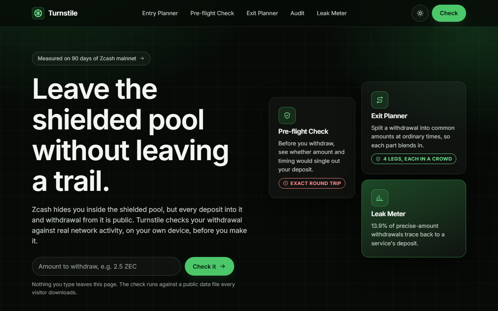
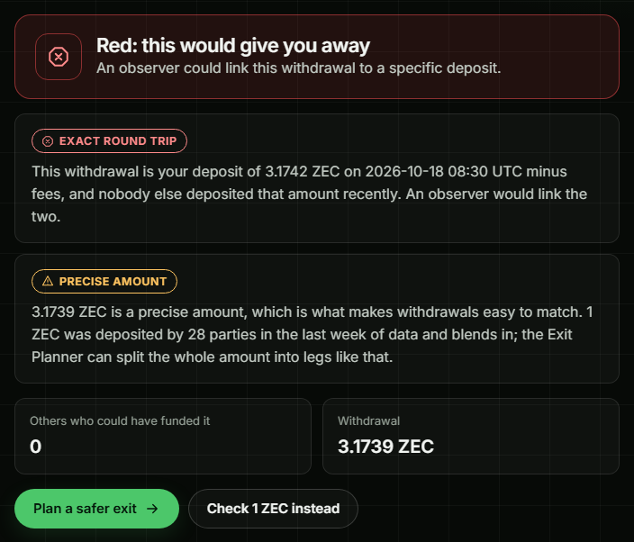
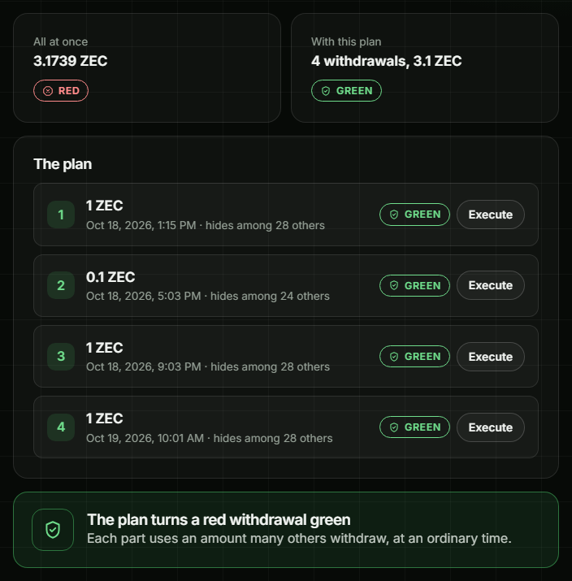
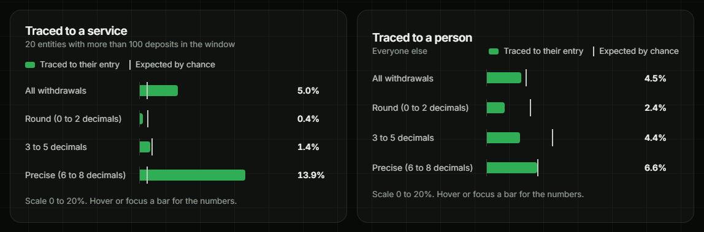

# Turnstile

**Zcash's shielded pool hides you inside. Its doors are public.**

Every deposit into the shielded pool and every withdrawal out of it is published on chain: the amount and
the time. Turnstile measures how often that betrays people, warns you before a withdrawal gives you away,
and plans an exit that blends in. Every check runs on your own device, against public data that every
visitor downloads, so no server ever learns what you are about to do.

**[Open the live app](https://turnstile-psi.vercel.app)** ·
**[Watch the 2-minute demo](https://drive.google.com/file/d/1SZsk0QYa2x_UxB7f-sISXQbUJLcXjdKL/view)** ·
**[Read the methodology](docs/methodology.md)**

Built for [Zecathon](https://thezecathon.com/), Cross-Chain track. TypeScript, MIT licensed.



## What we found on Zcash mainnet

| | |
|---|---|
| **About 1 in 7** | precise-amount withdrawals by services (exchanges, bridges, payment processors) trace straight back to their deposit, against under 1% by chance |
| **100%** | of exact round trips on an amount nobody else used are caught: 1,269 of 1,269 planted trips, whether the person waited an hour or a day |
| **85%** | is how often an observer who simply picks the closest deposit in time is right, when even a *common* amount is withdrawn an hour after it went in |
| **89.8%** | of shielded-pool crossings are invisible to a major block explorer's shielded-value field, because it only reads the older pools |

People as a whole show nothing beyond chance, which is exactly why the problem goes unnoticed. The risk is
specific to the person and the withdrawal, so it can't be read off an average. It has to be checked before
each withdrawal. That is what Turnstile does.

## The problem, in one story

Kemi buys 3.1742 ZEC on an exchange that knows her name. She shields it at 14:05, and inside the pool
nobody can see her.

At 17:30 she swaps it for USDC through a cross-chain service, so 3.1742 ZEC, minus a fee, leaves the pool.

The chain now shows that 3.1742 ZEC went in at 14:05 and the same amount came out three and a half hours
later. Nobody else moved that amount that afternoon. The two events are one person, and Kemi's identity at
the exchange is linked to wherever the USDC went. Her wallet showed a shield icon the whole time.

Researchers described this round-trip leak in 2017
([Quesnelle](https://arxiv.org/abs/1712.01210)), and the Zcash
[privacy recommendations](https://zcash.readthedocs.io/en/master/rtd_pages/privacy_recommendations_best_practices.html)
acknowledge it. Most people still cross the boundary twice, in from an exchange and out through a swap,
and no wallet warns them.

## What Turnstile does

<table>
<tr>
<td width="50%"></td>
<td width="50%"></td>
</tr>
<tr>
<td><b>Pre-flight Check.</b> Kemi's withdrawal is her deposit minus fees, and nobody else used that amount. Red.</td>
<td><b>Exit Planner.</b> The same money in common amounts at ordinary times, never adding back up to her deposit. Green.</td>
</tr>
</table>

| Tool | What it answers |
|---|---|
| **Pre-flight Check** | Would this withdrawal give me away? Compares it with every recent deposit and says how many parties it could belong to, including when the answer is only you. |
| **Exit Planner** | How do I take it out safely? Splits a withdrawal into amounts many others use, at hours when others withdraw, and proves no group of legs adds back up to the deposit. |
| **Execute, through NEAR Intents** | Each leg becomes a cross-chain swap: a verified quote, a one-time deposit address and a [ZIP 321](https://zips.z.cash/zip-0321) payment QR you pay from your own wallet. |
| **Entry Planner** | Half of every leak is made on the way in. Before you deposit, it tells you whether the amount would become a fingerprint, and what to do instead. |
| **Personal Audit** | Did my past withdrawals give me away? Paste your transparent addresses and see which crossings point back at your deposits. |
| **Leak Meter** | How bad is it, network-wide? A reproducible measurement on 90 days of mainnet, always compared with two independent estimates of pure chance. |
| **`@turnstile/core`** | The whole engine as a small TypeScript library with no runtime dependencies, so any wallet can show the warning before a user withdraws. |

## Why you can trust it

**It can't leak what you tell it.** A tool that asks a server "is 3.1742 ZEC risky?" has already leaked the
very thing it was meant to protect. Turnstile asks nothing. Every visitor downloads the same public files, about 2.3 MB, and every
check, plan and audit runs in the browser. After the download, the page makes no network requests at all,
and an end-to-end test checks exactly that in three browsers. There are no analytics, no third-party scripts and
no keys: you pay from your own wallet. NEAR Intents is the one outside service, contacted one leg at a
time, only when you ask for a price, after a plain statement of what it will see. The audit is built so it
can't be pointed at a stranger: for addresses you didn't enter, it says that a link exists, never where it
leads.

**Every number can be reproduced.** The data is rebuilt every day by a public GitHub Action from
Blockchair's free daily dumps. The build is deterministic: on its first run, GitHub's Linux machine
produced the same snapshot, byte for byte, as an independent build on Windows. Every file carries a
SHA-256 hash that the app checks before use, so one altered byte is refused.

**The data was checked before it was trusted.**

- Crossings are detected from the structure of each transaction, not from any explorer's summary:
  a purely transparent transaction leaves exactly 27, 23 or 24 bytes unexplained (by version), and every
  shielded one leaves more than 200. Across 590,212 transactions there is nothing in between.
- 20 of 20 randomly sampled crossings match a Zcash node exactly, across Sapling, Orchard and Ironwood.
- Blockchair's dumps repeat 118,086 lines over 90 days; Turnstile drops exact copies and rejects
  conflicting ones.

**The matcher is built to under-claim.** It only links a withdrawal when the gap to a deposit is an exact
multiple of the ZIP 317 fee unit, it counts a service's thousands of deposits as one party, and it refuses
to link an amount anyone else used in the previous two weeks. In 3,000 planted round trips it never blamed
the wrong deposit.

**It has been attacked on purpose.**

| | |
|---|---|
| 180 | unit tests, including published test vectors for every address format (ZIP 320, BIP 173, BIP 350, EIP-55) |
| 346 | end-to-end tests of the production build in Chromium, Firefox and WebKit: failures, accessibility, layout from 320 px, privacy, speed |
| 57,000 | hostile inputs through every core function (`scripts/stress-core.mjs`), with no crash, hang or leak |
| 1 | seeded random user that types garbage into every form, double-clicks, navigates and resizes (`e2e/fuzz.spec.ts`) |
| 5 | separate code reviews (core, data, web app, payments, build), every finding fixed with a test ([web test plan](docs/web-test-plan.md)) |

## How it maps to the judging criteria

| Criterion | The evidence |
|---|---|
| **Privacy** | Nothing you type leaves the device; zero requests after load, tested in three browsers; strict Content Security Policy; no keys; the audit reveals nothing about addresses you didn't enter. |
| **Usefulness** | A red or green answer in under a second for the withdrawal you are about to make, and a plan that turns red into green, executable across chains today. |
| **Execution** | Live, updated daily, reproducible byte for byte, 526 automated tests, every claim backed by a script in [`scripts/`](scripts). |
| **Originality** | A measurement of boundary leakage on today's mainnet, including the Orchard and Ironwood pools that earlier studies predate, always against chance, and a tool that acts on it before the withdrawal rather than after. |

## The measurement, in detail

36,129 withdrawals between July 22 and September 7, 2026, each compared with two independent measures of
coincidence: pairing withdrawals with deposits made *after* them, which can't be real, and nudging each
amount slightly, which keeps its shape but removes the true match.



| Withdrawals traced to | Linked to their deposit | By chance | Beyond chance |
|---|---|---|---|
| Services, precise amounts | **16.0%** | 0.04% to 0.73% | **+15.3 points** |
| Services, all amounts | 6.5% | 0.45% to 0.54% | +6.0 points |
| People | 4.4% | 3.7% to 4.8% | none measurable |

Re-run on the 90 days to October 11 (49,660 withdrawals), services' precise amounts were linked 14.2% of
the time against 0.05% to 1.0% by chance, and people showed nothing beyond chance again. The live Leak
Meter shows the current window.

**Timing leaks on its own.** A common amount protects you from amount matching, not from the clock. In 600
deposits planted into real mainnet data, an observer who picks the matching deposit closest in time was
right this often:

| Withdrawn after | Precise amount, withdrawn whole | Common amount, withdrawn whole | Deposited whole, withdrawn with the Exit Planner |
|---|---|---|---|
| 1 hour | 99.8% | 84.9% | 0.0% |
| 1 day | 96.8% | 10.8% | 0.0% |
| 3 days | 93.2% | 3.5% | 0.0% |

Waiting doesn't save a precise amount, and a common amount still needs time. Splitting the exit so no part
matches the deposit removes both, which is why the Pre-flight Check warns when your deposit would be the
closest in time, and the Entry Planner's first advice is to leave through the Exit Planner. Method,
calibration and every figure: [docs/methodology.md](docs/methodology.md).

## How it works

```
Blockchair daily dumps ──▶ ingest ──▶ boundary events ──▶ snapshot + manifest (public, hashed)
   (rebuilt every day by a GitHub Action)                          │
                                                                   ▼
                                     your browser:  @turnstile/core  score · plan · audit  (all local)
                                                                   │
                                     only when you ask, one leg at a time
                                                                   ▼
                                     NEAR Intents quote ──▶ verified ──▶ ZIP 321 QR ──▶ your own wallet
```

1. **Detect.** For each transaction, compare its size with the exact size of its transparent parts. Anything
   left over beyond a fixed header is shielded data. For those, the transparent value going in versus coming
   out gives the direction and the amount of the crossing.
2. **Match.** For each withdrawal, find the deposits that could have funded it: earlier, slightly larger,
   with a gap that looks like fees. Group deposits by who made them, weigh recent ones and exact fee
   multiples most, and refuse to call a link on an amount that others use.
3. **Check against chance.** Run the same matcher backwards in time and on nudged amounts. Only what rises
   above both counts.
4. **Act.** The Check, Planner, Entry Planner and Audit run that matcher on your own numbers, in your
   browser, against the downloaded snapshot.

## Cross-chain execution, verified

The Exit Planner's legs go out through the [NEAR Intents](https://docs.near-intents.org) 1Click API,
called directly from the browser. Turnstile doesn't take the answer on trust:

- The quote must match what was asked: the same amount, recipient and refund address. The deposit address
  must be a valid, checksummed transparent Zcash address, or the page refuses to show it.
- Recipient addresses are checked against their chain's own checksum before anything is sent.
- The fee shown is the fee NEAR Intents reports in the quote, with the refund cost and a warning when a
  small swap loses more than 5% to fees.
- The plan locks while a payment is open, so the QR always asks for exactly the amount that was quoted.

`scripts/verify-intents.mjs` checks all of this against the live API without moving any funds.

## Try it

The fastest way is the **[live app](https://turnstile-psi.vercel.app)**. To run it yourself you need Node
22.13 or later and [pnpm](https://pnpm.io/).

```sh
pnpm install
pnpm build          # needs a snapshot in data/snapshot (below)
pnpm test           # 180 unit tests
```

Rebuild the data and reproduce the findings (Blockchair limits free downloads to about 100 KB/s, so 90
days take about 1.5 hours the first time; downloads are cached):

```sh
node apps/cli/dist/bin.js ingest --days 90 --to 2026-10-17
node apps/cli/dist/bin.js derive --days 90 --to 2026-10-17
node apps/cli/dist/bin.js meter  --days 90 --to 2026-10-17     # the Leak Meter
node apps/cli/dist/bin.js snapshot --days 90 --to 2026-10-17   # the bundle the app downloads
pnpm --filter @turnstile/web preview                           # the app, locally
```

The same tools from the command line, with any amounts:

```sh
node apps/cli/dist/bin.js check 3.1739 --deposit 3.1742 --deposit-at 2026-10-17T09:00Z
node apps/cli/dist/bin.js plan 3.1739 --hours 48 --ics plan.ics
node apps/cli/dist/bin.js enter 3.1742
node apps/cli/dist/bin.js audit t1...
node apps/cli/dist/bin.js quote 1 --to usdc-base --recipient 0x... --refund u1...   # a price; --live for an address
```

Every claim above has a script that checks it:

| Script | Checks |
|---|---|
| `scripts/verify-ingest.mjs` | every stored day matches its source file, read without Turnstile's parser |
| `scripts/verify-events.mjs` | 20 random crossings against a public Zcash node |
| `scripts/verify-snapshot.mjs` | the bundle verifies and decodes in Node and in Chromium; tampering is refused |
| `scripts/verify-preflight.mjs` | real identifiable deposits come out red; plans are sum-safe |
| `scripts/verify-entry.mjs` | the deposit advice, backtested on 600 planted deposits |
| `scripts/verify-audit.mjs` | the audit agrees with the matcher and discloses nothing about other people |
| `scripts/verify-intents.mjs` | NEAR Intents behaves as the app expects, with no funds moved |
| `scripts/stress-core.mjs` | thousands of hostile inputs through every function |

## Repository

| Path | What it holds |
|---|---|
| [`packages/core`](packages/core) | `@turnstile/core`: matching, scoring, planning, the audit; runs in browsers and Node |
| [`packages/ingest`](packages/ingest) | Verified ingestion of Blockchair dumps and structural crossing detection |
| [`packages/intents`](packages/intents) | The NEAR Intents client, the only code allowed to contact a third party |
| [`apps/web`](apps/web) | The web app |
| [`apps/cli`](apps/cli) | The `turnstile` command-line tool |
| [`scripts`](scripts) | Independent verification, stress testing, the daily data job's helpers, the demo recording |
| [`docs`](docs) | [Methodology](docs/methodology.md), [design](docs/turnstile-design.md), [web test plan](docs/web-test-plan.md) |
| [`PRD.md`](PRD.md) | Requirements and the acceptance tests every build section had to pass |

## Limitations

Turnstile measures what the public chain reveals. It can't see inside the shielded pool, and that is the
point. A low score is a warning about what an observer could infer, not proof that anyone has. A
transaction that shields and deshields in the same step nets out and is under-counted. The data comes from
Blockchair's public dumps; the ingestion layer is built so a Zcash node can replace them without changing
anything downstream. Timing advice is measured on the past 90 days and can drift as network activity
changes, which is why the data is rebuilt daily.

## Related work

Turnstile builds on [Quesnelle (2017)](https://arxiv.org/abs/1712.01210), which matched round trips by
amount and time in the Sprout era. [Zec Tracker](https://zcash-explorer.net/analysis.html) offers an
on-demand scanner that correlates shields and deshields with adjustable tolerances, for investigating what
already happened. Turnstile asks a different question, before the fact: is the withdrawal *you are about to
make* linkable, and what should you do instead? To answer it honestly, it measures every result against
chance, separates services from people, plans legs that can't be added back up to your deposit, and runs
entirely on your device.

## License

[MIT](LICENSE)
